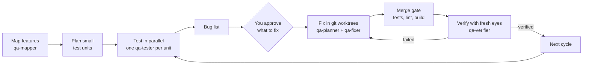

# QA Cycle: whole-app QA for Claude Code, run by a team of agents

**QA Cycle is a Claude Code plugin that tests your entire app, fixes the bugs it finds and proves each fix
works.** It maps every feature from the code, tests each one with a separate agent, hands you a bug list to
approve, fixes the approved bugs in isolated git worktrees, and has a fresh agent verify every fix — cycle
after cycle, until nothing you asked to fix is left. Android, iOS, web and non-UI code (CLIs, APIs, libraries).

[](LICENSE)


One agent asked to "test the app and fix what's broken" tests what it happens to open, grades its own fixes,
forgets after compaction, and collides with itself when parallelized. QA Cycle works like a QA team instead:
small units, one agent each, a durable record, and someone other than the fixer signing off.

## Install

```
/plugin marketplace add DrunkenDealer/claude-code-qa-cycle
/plugin install qa-cycle@qa-cycle
```

Then open your project and ask **"Run a QA cycle on this app"** (or `/qa-cycle:qa-cycle`). The first run
walks you through setup. To test one area only, say so: "QA only the notifications area".

| You want to… | Use |
|---|---|
| Test the whole app (or one area), then fix and re-verify in cycles | `/qa-cycle:qa-cycle` (`map`, `test`, `fix`, `verify`, `status` run one phase) |
| Check one feature you just built before shipping | `/qa-cycle:regression` |
| Get a tester's bug list for a diff or PR | `/qa-cycle:manual-qa` |

## How a cycle works



1. **Map** the code into features, states and cross-feature flows, then cut it into small test units.
2. **Test** one unit per agent, each in its own sandbox and port range; every finding is reproduced twice.
3. **List** deduplicated findings by severity (blocker, major, minor). **Nothing is fixed until you approve.**
   Planners start on risky items while you decide, and you get a notification when the loop waits on you.
4. **Fix** in one git worktree per fixer; anything touching state, history, concurrency or stored data gets
   a written plan first.
5. **Merge** one branch at a time behind your tests, lint and build. If anything fails, nothing lands.
6. **Verify** with an agent that didn't write the fix: the original repro, variants, every step, nearby fixes.
7. **Loop** until `done.mjs` reports READY, then `close.mjs` frees every sandbox, port, device and worktree
   the loop left behind.

## What's inside

| Component | Model | Role |
|---|---|---|
| `qa-cycle` skill | your session model | Orchestrator: dispatches agents, merges, keeps the record, asks you at the gates |
| `qa-mapper` | Sonnet | Builds the feature map (read-only) |
| `qa-tester` | Sonnet | Tests one unit in a sandbox; never fixes |
| `qa-planner` | Opus | Writes and revises fix plans (read-only) |
| `qa-fixer` | Sonnet | Implements one fix in its own worktree; reports a plan gap rather than redesigning |
| `qa-verifier` | Sonnet | Adversarially re-checks one merged fix; never the agent that wrote it |
| `regression`, `manual-qa` skills | — | Single-change checks against platform checklists (Material, HIG, WCAG 2.2 AA, non-UI) |
| `scripts/` | Node.js | Tracker, sandboxes, merge gate, exit criteria (`done`), cleanup (`close`), playbook check |

## Safety and data

- **You decide at the gates** — the fix list, product questions, trade-offs, each new cycle. Opt in to
  `autoAccept: "recommended"` and it takes the recommended option instead, logs each one and lists them in
  the final report; destructive, production, scope and residual-defect decisions are still asked.
- **No self-grading.** An item is verified only when a different agent proves it on current main.
- **Isolation.** Own worktree per fixer, own sandbox and ports per tester and verifier. Nothing touches
  production, shared state or real payments; `offLimits` files are never opened.
- **Local only.** Commits stay local in your identity, with no AI trailer, and are never pushed. No network
  calls of its own, no MCP servers. Shell commands and edits go through your normal permission prompts.
- **Survives long runs.** The tracker and tooling folder live outside the session; agents checkpoint their
  progress, a usage-limit stop resumes from it, and a stamped how-to playbook carries what agents learned
  about driving your app into the next brief.

## Manual setup

1. Create a tooling folder outside the repo, e.g. `~/.claude/projects/<project>/qa-fix/`, and link the scripts:

   ```sh
   SKILL=<path to the installed plugin>/skills/qa-cycle
   cd <tooling>
   for f in $SKILL/scripts/*.mjs $SKILL/scripts/*.sh; do ln -sf "$(realpath "$f")" "$(basename "$f")"; done
   cp $SKILL/scripts/qa.config.example.json qa.config.json
   ```

2. Fill in `qa.config.json`: repo path, test/lint/build commands, port ranges, what must never be touched,
   and optionally `scope` and `autoAccept`.
3. Run `node mkrules.mjs` to generate the agents' `FIXRULES.md` and `VERIFYRULES.md`. For mobile apps, write
   them by hand from the templates in `references/` and point testers at your emulator or simulator.
4. Add `.claude/worktrees/` to your project's `.gitignore`.

## Requirements and cost

- Claude Code, git and Node.js 18+, on macOS or Linux. Not supported in Claude Cowork or on claude.ai.
- **It uses a lot of tokens:** a cycle starts dozens of agents. Start with one area to see what a cycle costs.
- Works best with a test suite and a build command, so the merge gate has something to enforce.

Built while running it on a Kotlin Multiplatform app and a web app: 200+ findings tracked, the mobile app's
first cycle found 4 blockers and 51 majors, fixed in 141 small commits, each verified by a separate agent.

## Development

```sh
node --test tests/scripts.test.mjs   # deterministic script tests
claude plugin eval . --ablation none --runs 2 --no-publish --trust-plugin   # behavior evals in evals/
```

Compact eval results per version are kept in `evals/history/` for comparison. Issues and pull requests are
welcome — include the project type and the tracker item or agent report that showed the problem. See
[CHANGELOG.md](CHANGELOG.md).

## License

[MIT](LICENSE) © Max Shwed
